# Kanban: канбан-доска с CI/CD, контейнером и мониторингом

Домашнее задание: **развернуть приложение в контейнере + мониторинг**, выполнить весь процесс CI/CD и описать его.

|  |  |
|---|---|
| **Студент** | Михеев Максим Владимирович |
| **Группа** | Фт-340007 |
| **Дисциплина** | Системное программное обеспечение |
| **Приложение** | Канбан-доска (React + FastAPI + PostgreSQL) |

---

## 1. Требования задания и как они выполнены

Это краткая проверочная таблица. Подробности и скриншоты по каждому пункту дальше по тексту.

| Требование | Выполнено | Где посмотреть |
|---|---|---|
| Приложение с интерфейсом | ✅ Веб-интерфейс канбан-доски | [Приложение](https://kanban-board-xzhc.onrender.com/) |
| Исходный код в git | ✅ GitHub | [Репозиторий](https://github.com/w0wFunix/kanban-board) |
| Настроена сборка приложения | ✅ `scripts/build.sh`, стадия `build` | [Раздел 4](#4-сборка-и-артефакт) |
| Артефакт сборки сохраняется | ✅ `kanban-build` в GitHub Actions | [Раздел 4](#4-сборка-и-артефакт) |
| Артефакт берётся процессом и упаковывается в контейнер | ✅ стадия `package`, `Dockerfile` | [Раздел 5](#5-контейнер) |
| Контейнер разворачивается на сервере | ✅ Render, стадия `deploy` | [Раздел 6](#6-деплой-на-сервер) |
| Данные сохраняются | ✅ внешняя база Neon PostgreSQL | [Раздел 7](#7-хранение-данных-и-редактирование) |
| Приложение не только запускается, но и редактируется | ✅ создание, изменение, перенос, удаление карточек; правка кода через пайплайн | [Раздел 7](#7-хранение-данных-и-редактирование), [раздел 9](#9-редактирование-кода-через-пайплайн) |
| Метрика: ресурсы (потребляемые и доступные) | ✅ CPU, RAM, диск | [Раздел 8](#8-мониторинг) |
| Метрика: health check | ✅ `/health` + проверки Render и UptimeRobot | [Раздел 8](#8-мониторинг) |
| Метрика: посещения в час | ✅ график и `/api/stats/hourly` | [Раздел 8](#8-мониторинг) |
| Сдать скрипты сборки и деплоя | ✅ папка [`scripts/`](scripts) | [Раздел 3](#3-структура-репозитория) |
| Сдать файл описания контейнера | ✅ [`Dockerfile`](Dockerfile) | [Раздел 5](#5-контейнер) |
| Ссылка на работающее приложение и на метрики | ✅ | [Раздел 2](#2-ссылки) |
| Скрипты, чтобы можно было запустить исходники | ✅ `./scripts/run_local.sh` | [Раздел 10](#10-запуск-для-преподавателя) |

---

## 2. Ссылки

| Что | Ссылка |
|---|---|
| **Работающее приложение** | https://kanban-board-xzhc.onrender.com/ |
| **Метрики и мониторинг** (ресурсы, health, посещения в час) | https://kanban-board-xzhc.onrender.com/dashboard |
| Health check | https://kanban-board-xzhc.onrender.com/health |
| Метрики в формате Prometheus | https://kanban-board-xzhc.onrender.com/metrics |
| Документация API (Swagger) | https://kanban-board-xzhc.onrender.com/docs |
| Внешний мониторинг (UptimeRobot) | https://stats.uptimerobot.com/j0TNjHPOxB |
| Исходный код | https://github.com/w0wFunix/kanban-board |
| Пайплайн CI/CD | https://github.com/w0wFunix/kanban-board/actions |
| Docker-образ | `docker pull ghcr.io/w0wfunix/kanban-board:latest` |

> ⚠️ **Сервер работает на бесплатном тарифе Render и «засыпает» после 15 минут без запросов.** Первое открытие после простоя может занять около минуты. Это не ошибка, просто подождите загрузки. Чтобы сервер не засыпал, его каждые 5 минут опрашивает UptimeRobot.

---

## 3. Структура репозитория

```
backend/
  app/main.py            API, /health, /metrics, /dashboard
  tests/test_api.py      автотесты
  requirements.txt       зависимости приложения
  requirements-dev.txt   зависимости для тестов и линтера
frontend/                React (Vite): интерфейс доски
docs/screenshots/        скриншоты
scripts/
  build.sh               сборка и упаковка артефакта
  deploy.sh              деплой на Render и проверка /health
  run_local.sh           локальный запуск: сборка + docker compose
Dockerfile               описание контейнера
docker-compose.yml       приложение + Prometheus + Grafana (локально)
prometheus/prometheus.yml
grafana/provisioning/    автоподключение источника данных Grafana
.github/workflows/ci-cd.yml   пайплайн
```

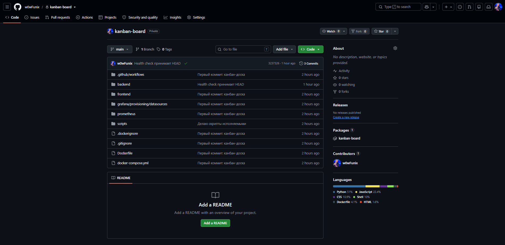

---

## 4. Сборка и артефакт

Весь процесс описан в файле [`.github/workflows/ci-cd.yml`](.github/workflows/ci-cd.yml) и запускается автоматически при каждом `git push` в ветку `main`.

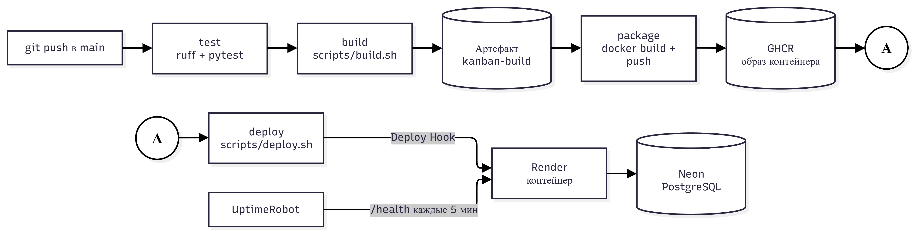

### Стадии пайплайна

| Стадия | Что делает |
|---|---|
| **test** | Устанавливает зависимости, проверяет код линтером `ruff`, запускает тесты `pytest` (создание, изменение, удаление карточек, `/health`, `/metrics`, статистика) |
| **build** | Запускает [`scripts/build.sh`](scripts/build.sh): собирает React-фронтенд, копирует backend и упаковывает всё в архив `kanban-<sha коммита>.tar.gz`. Архив сохраняется как **артефакт** |
| **package** | Скачивает артефакт, распаковывает в `build/`, собирает по `Dockerfile` образ и публикует в GitHub Container Registry с тегами `latest` и `<sha коммита>` |
| **deploy** | Запускает [`scripts/deploy.sh`](scripts/deploy.sh): вызывает Deploy Hook Render, затем до 5 минут опрашивает `/health`. Если приложение не ответило, стадия падает |

Для pull request выполняются только `test` и `build`, полный цикл с деплоем идёт только для `main`.

### Успешный запуск пайплайна

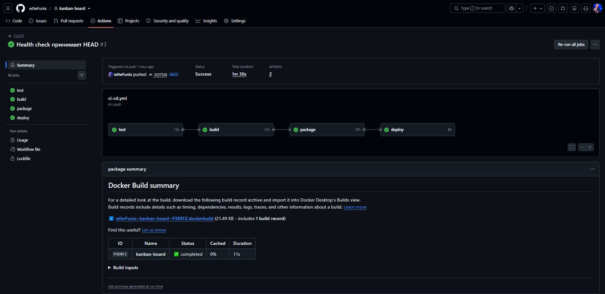

### Артефакт сборки

Архив, созданный стадией `build` и сохранённый для следующей стадии:

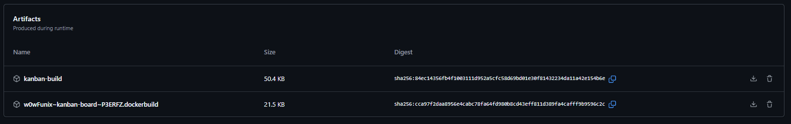

### Секреты пайплайна

Чувствительные данные не хранятся в коде, они заданы в GitHub Secrets (значения скрыты самим GitHub):

| Секрет | Назначение |
|---|---|
| `RENDER_DEPLOY_HOOK` | адрес Deploy Hook сервиса на Render |
| `APP_URL` | адрес приложения для проверки `/health` |

Для публикации образа используется встроенный `GITHUB_TOKEN`.

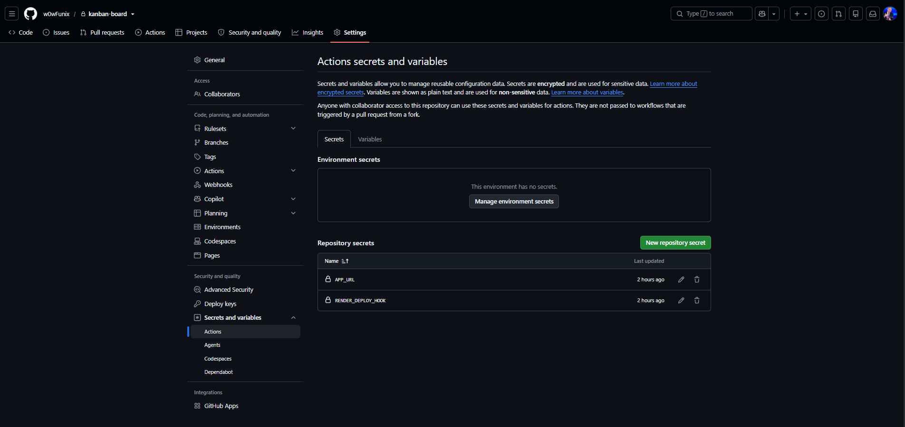

---

## 5. Контейнер

[`Dockerfile`](Dockerfile) собирает образ **из артефакта** (папка `build/`, то есть распакованный `kanban-*.tar.gz`), а не из исходников. Так выполняется требование «артефакт берётся процессом и упаковывается в контейнер».

- базовый образ `python:3.12-slim`;
- установка зависимостей из `requirements.txt`;
- копирование приложения и собранного фронтенда;
- запуск от непривилегированного пользователя `app`;
- `HEALTHCHECK` обращается к `/health`;
- порт берётся из переменной окружения `PORT` (на Render задаётся автоматически), запуск через `uvicorn`.

Готовый образ публикуется в GitHub Container Registry:

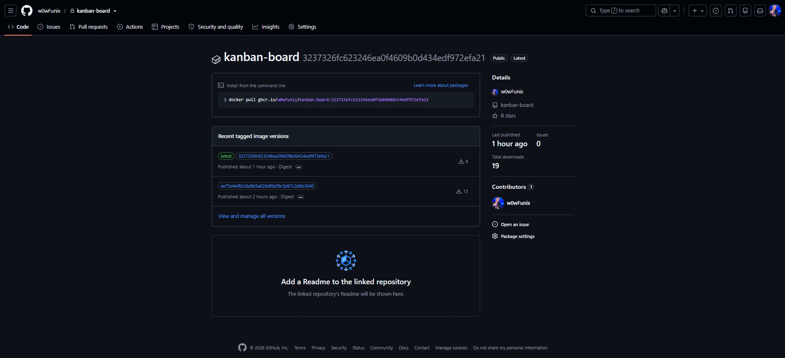

---

## 6. Деплой на сервер

Контейнер разворачивается на платформе **Render** (Web Service → Existing Image, образ из GHCR, тариф Free). Деплой запускает пайплайн: [`scripts/deploy.sh`](scripts/deploy.sh) вызывает Deploy Hook с указанием образа, помеченного хэшем коммита, после чего ждёт, пока `/health` вернёт `200`.

Настройки сервиса:
- Health Check Path: `/health` (Render сам проверяет приложение и перезапускает контейнер при сбоях);
- переменная окружения `DATABASE_URL` (строка подключения к Neon);
- автодеплой отключён: выкатка происходит только из пайплайна.

### Стадия deploy в пайплайне

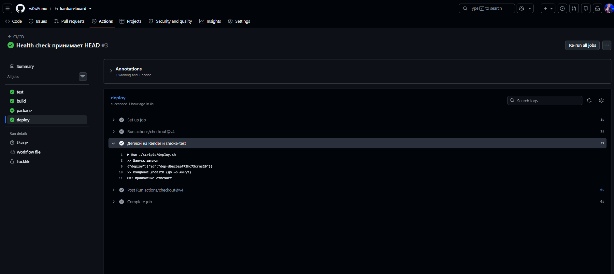

### Сервис на Render

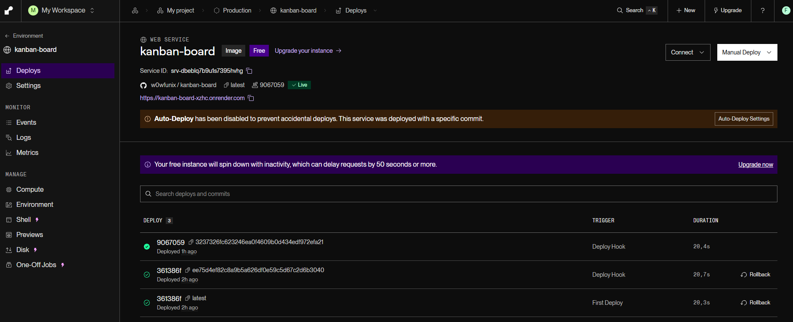

Образ контейнера: `ghcr.io/w0wfunix/kanban-board`.

### Настройки: Health Check

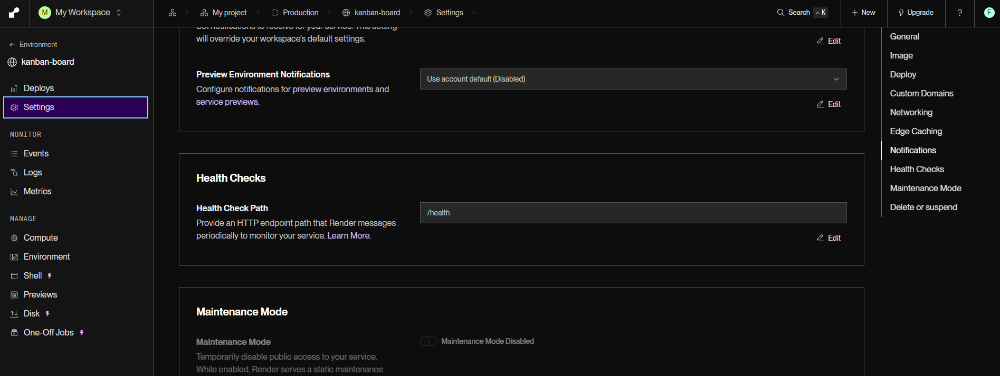

### Настройки: образ

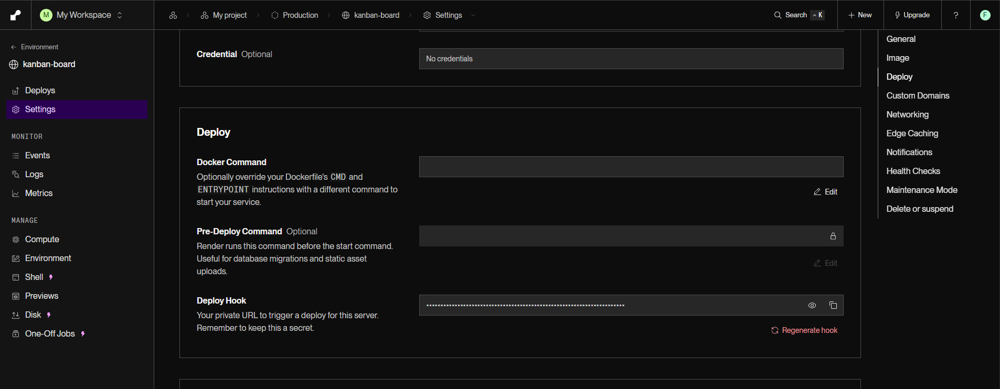

### Логи запуска контейнера

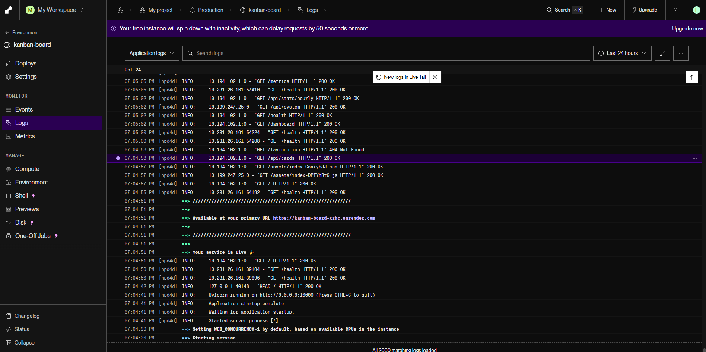

---

## 7. Хранение данных и редактирование

Контейнер на бесплатном Render не хранит данные между перезапусками: файловая система сбрасывается при каждом деплое и «засыпании». Поэтому данные хранятся во внешней базе **Neon PostgreSQL**. Строка подключения передаётся через `DATABASE_URL` (в репозитории её нет). Таблицы `cards` (карточки) и `visits` (посещения) создаются приложением автоматически при запуске.

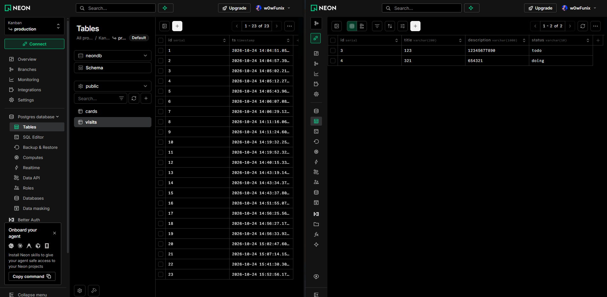

### Работа с приложением

Доска состоит из трёх колонок: «К выполнению», «В работе», «Готово». Можно:
- добавить карточку;
- изменить название и описание;
- перенести карточку мышью или кнопками ← →;
- удалить карточку.

Все изменения сохраняются в базе и остаются после перезагрузки страницы и перезапуска контейнера.

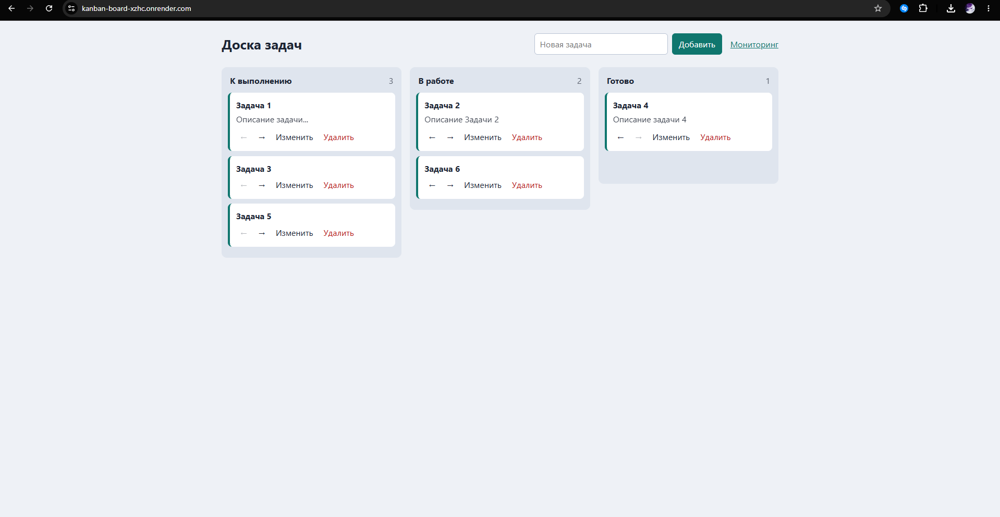

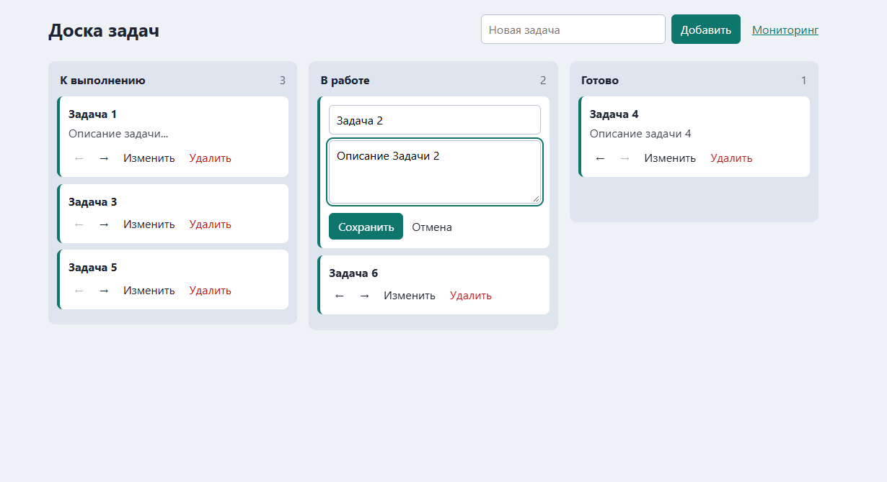

### API

| Метод | Адрес | Описание |
|---|---|---|
| GET | `/api/cards` | список карточек |
| POST | `/api/cards` | создать карточку |
| PATCH | `/api/cards/{id}` | изменить или перенести карточку |
| DELETE | `/api/cards/{id}` | удалить карточку |
| GET | `/api/system` | CPU, память, диск, аптайм |
| GET | `/api/stats/hourly` | посещения по часам за 24 часа |
| GET | `/health` | проверка состояния |
| GET | `/metrics` | метрики Prometheus |

Интерактивная документация доступна по адресу `/docs`.

---

## 8. Мониторинг

Встроенные графики Render (Metrics) недоступны на бесплатном тарифе, поэтому мониторинг реализован в самом приложении и дополнен внешними сервисами.

| Метрика | Что показывает | Где смотреть |
|---|---|---|
| **Ресурсы** (потребляемые и доступные) | CPU, % · память: занято из всего · диск: занято из всего | [`/dashboard`](https://kanban-board-xzhc.onrender.com/dashboard), `/metrics` |
| **Health check** | `GET /health` возвращает `200` и `{"status":"ok","db":"ok"}`; при недоступной БД возвращает `503` | [`/health`](https://kanban-board-xzhc.onrender.com/health), UptimeRobot, Render |
| **Посещения в час** | график за 24 часа, счётчик `app_visits_total` | `/dashboard`, `/api/stats/hourly`, `/metrics` |

### Как считаются «посещения в час»

Каждое открытие главной страницы `/` или `/dashboard` записывается в таблицу `visits` с временем (UTC). Запросы к `/health`, `/metrics` и `/api/*` **не считаются**, иначе пинги мониторинга искажали бы статистику. Эндпоинт `/api/stats/hourly` возвращает количество посещений по каждому из последних 24 часов, а `/dashboard` рисует их столбиками.

### Страница мониторинга `/dashboard`

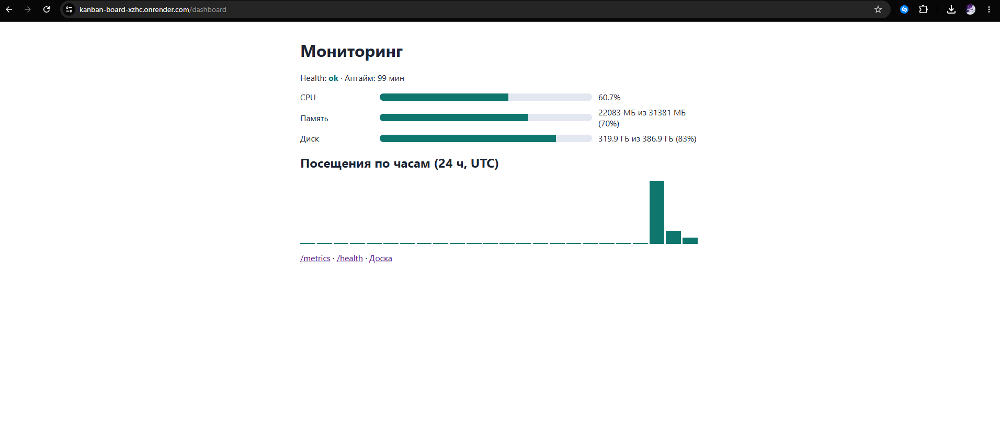

### Health check

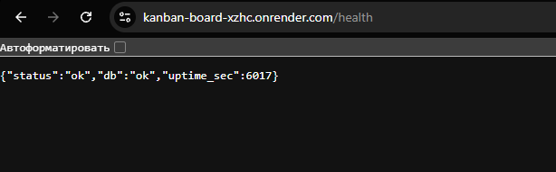

### Метрики в формате Prometheus

Метрики: `app_cpu_percent`, `app_memory_used_bytes`, `app_memory_total_bytes`, `app_disk_used_bytes`, `app_disk_total_bytes`, `app_visits_total`.

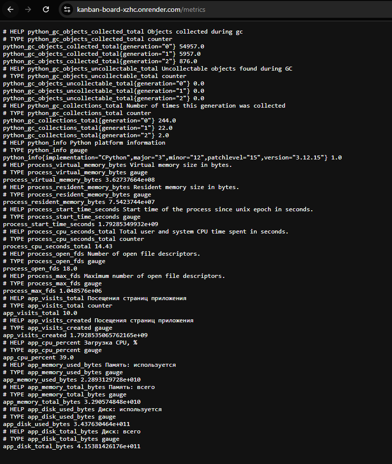

### Внешний мониторинг: UptimeRobot

Сервис проверяет `/health` каждые 5 минут, показывает аптайм и не даёт бесплатному серверу «засыпать».

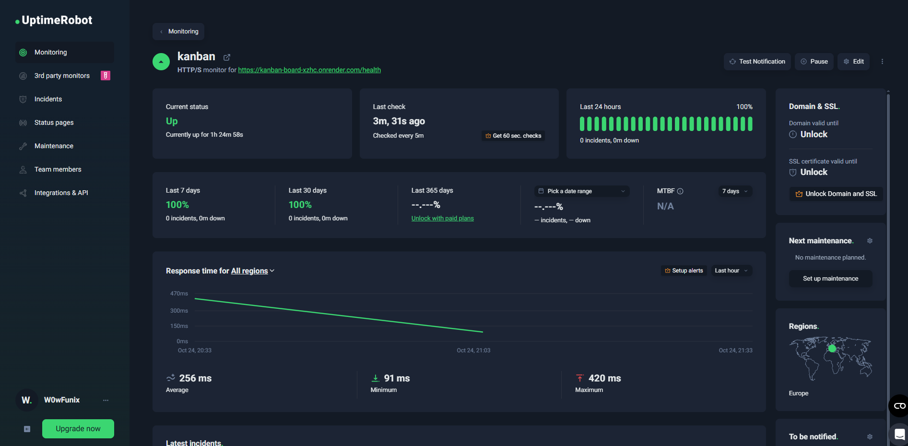

Публичная статус-страница: https://stats.uptimerobot.com/j0TNjHPOxB

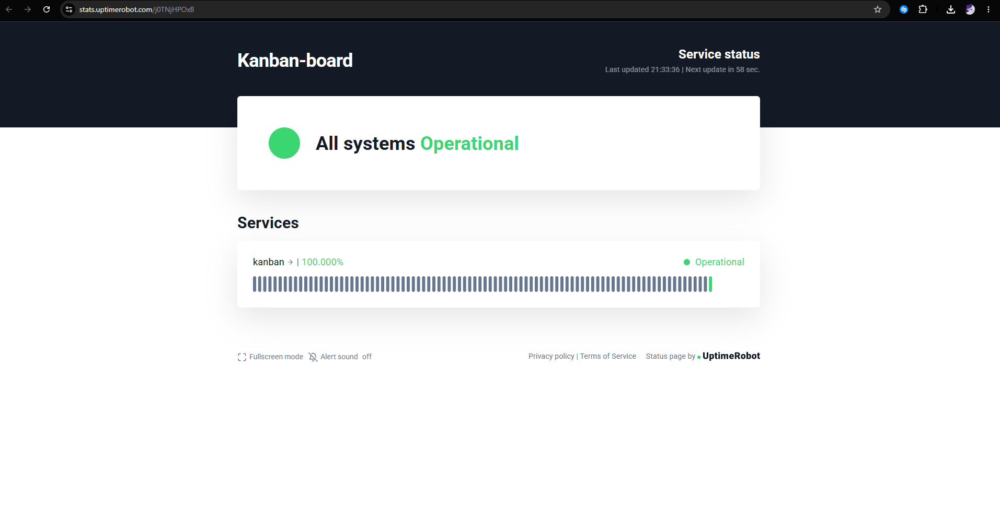

### Потребление ресурсов базы данных

Консоль Neon показывает потребление CPU и памяти базы данных:

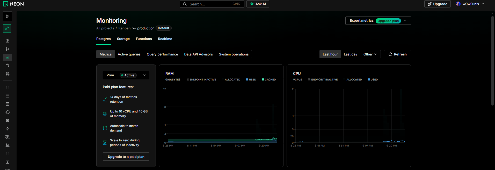

---

## 9. Редактирование кода через пайплайн

Демонстрация полного цикла: изменение кода → `git push` → автоматическая сборка и деплой → изменение на сайте. В примере заголовок в `frontend/src/App.jsx` изменён вручную.

**До изменения:**

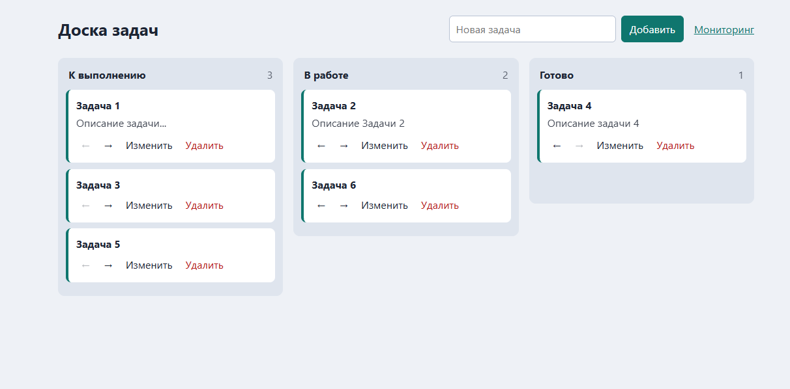

**Пайплайн, запущенный коммитом:**

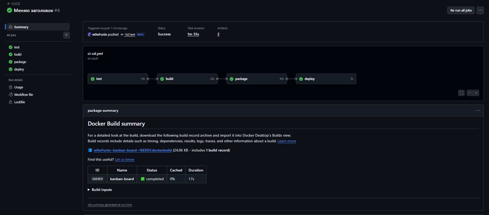

**После изменения:**

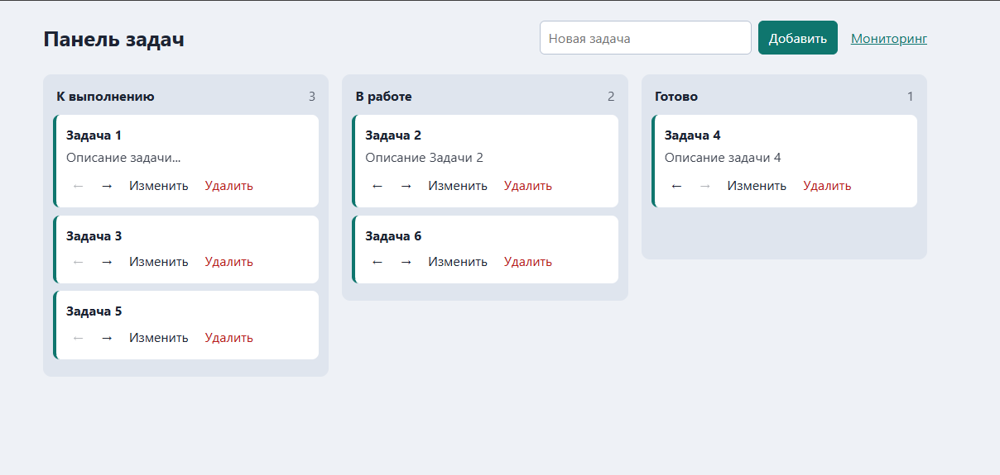

---

## 10. Запуск для преподавателя

Требования: **Git**, **Node.js 20**, **Docker** с Docker Compose. На Windows команды выполнять в Git Bash или WSL.

```bash
git clone https://github.com/w0wFunix/kanban-board.git
cd kanban-board
./scripts/run_local.sh
```

Скрипт соберёт фронтенд, создаст артефакт (`artifacts/kanban-dev.tar.gz`) и запустит контейнеры:

| Что | Адрес |
|---|---|
| Приложение | http://localhost:8000 |
| Мониторинг | http://localhost:8000/dashboard |
| Prometheus | http://localhost:9090 |
| Grafana | http://localhost:3000 (логин и пароль `admin`) |

Остановка: `Ctrl+C`, затем `docker compose down`. Локально данные хранятся в SQLite в Docker-томе, на сервере в PostgreSQL.

### Запуск без Docker (для разработки)

```bash
# backend
cd backend
pip install -r requirements-dev.txt
python -m pytest -q
uvicorn app.main:app --reload      # http://localhost:8000

# frontend (в другом терминале)
cd frontend
npm install
npm run dev                         # http://localhost:5173
```

### Быстрая проверка работоспособности

1. Откройте [приложение](https://kanban-board-xzhc.onrender.com/) (при первом открытии подождите до минуты).
2. Добавьте карточку, измените её, перенесите в другую колонку.
3. Обновите страницу: данные сохранились.
4. Откройте [`/dashboard`](https://kanban-board-xzhc.onrender.com/dashboard): ресурсы, health, посещения по часам.
5. В репозитории на вкладке [Actions](https://github.com/w0wFunix/kanban-board/actions) виден пайплайн и артефакт `kanban-build`.

---

## 11. Возникшие проблемы и решения

| Проблема | Причина | Решение |
|---|---|---|
| Стадия `build` падала с `Permission denied` (код 126) | На Windows Git не сохраняет право на запуск у `.sh` файлов | `git update-index --chmod=+x scripts/*.sh` |
| UptimeRobot показывал инцидент `404 Not Found` на `/health` | Мониторинг отправляет запрос методом `HEAD`, а `/health` принимал только `GET` | В коде `/health` разрешён метод `HEAD` |
| Данные пропадали бы при перезапуске контейнера | Файловая система контейнера на бесплатном Render временная | Данные вынесены в внешнюю БД Neon |

## 12. Ограничения

- Бесплатный тариф Render: сервер засыпает после 15 минут без запросов, первый запрос после простоя медленный.
- Встроенные метрики Render недоступны на бесплатном тарифе, поэтому мониторинг реализован в приложении.
- Время на графике посещений указано в UTC.
- Объём бесплатной базы Neon ограничен тарифом.# Kanban: канбан-доска с CI/CD, контейнером и мониторингом